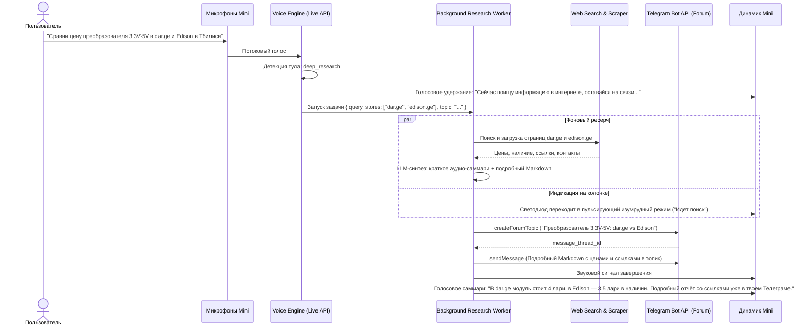

# План: Глубокий поиск (Deep Research) с голосовым саммари и отправкой в Telegram-форум

- Статус: planned
- Дата: 2026-11-10
- Владелец: gpt-mini, mini-assistant (`src/research/`, `src/telegram/`, `src/tools/`)

## Проблема и цель

Обычный голосовой режим (Live API) предназначен для коротких реплик «на лету» (погода, включение кондиционера, вызов плейлиста). Но когда пользователь просит выполнить детальный поисковый запрос (например: *«Найди преобразователь уровней с 3.3 на 5 вольт в магазине dar.ge в Тбилиси, сравни цену с магазином Edison и проверь наличие»* или *«Какие главные события произошли за сутки в Батуми?»*), потоковый голосовой режим не справляется:
1. Сессии Live API имеют жёсткие таймауты (10–15 сек) и не могут ждать глубокий парсинг веб-страниц.
2. Продиктовать голосом длинные ссылки, технические характеристики и таблицы цен невозможно для восприятия на слух.
3. Результаты поиска теряются после окончания голосовой сессии.

**Цель:**
1. Интеллектуальное распознавание длительного ресерча.
2. Голосовое удержание пользователя: ассистент сразу говорит: *«Я сейчас пойду и поищу инфу, оставайся на связи, сейчас я найду и тебе отвечу»*.
3. Фоновое выполнение глубокого поиска через поисковые API и веб-скрапинг.
4. Голосовой озвучивание краткого саммари на динамике GPT Mini.
5. Автоматическое создание **отдельного топика в Telegram-форуме (Supergroup Topics)** с подробным отчётом со ссылками, ценами и таблицами.

---

## Архитектура Deep Research



---

## Декларация инструмента `deep_research`

Для Gemini Live и OpenAI Realtime объявляется инструмент:

```json
{
  "name": "deep_research",
  "description": "Запускает глубокий многошаговый веб-поиск в реальном времени, когда пользователь запрашивает сравнение цен в конкретных магазинах (например, dar.ge, edison.ge), свежие локальные новости, расписания или сложную техническую информацию.",
  "parameters": {
    "type": "OBJECT",
    "properties": {
      "query": { "type": "STRING", "description": "Полный поисковый запрос пользователя" },
      "topic_title": { "type": "STRING", "description": "Короткий заголовок темы для Telegram форума (до 60 символов)" },
      "hold_phrase": { "type": "STRING", "description": "Фраза удержания для пользователя, например: 'Ищу наличие и цены в тбилисских магазинах, сейчас вернусь с ответом'" }
    },
    "required": ["query", "topic_title"]
  }
}
```

---

## Интеграция с Telegram Forum Supergroup (`src/telegram/forum.rs`)

1. **Конфигурация в `.env`:**
   ```env
   TELEGRAM_BOT_TOKEN="123456:ABC-DEF..."
   TELEGRAM_FORUM_CHAT_ID="-1001234567890" # ID супергруппы с включёнными темами (topics)
   ```
2. **Создание топика (`createForumTopic`):**
   - Вызов `POST https://api.telegram.org/bot<TOKEN>/createForumTopic`:
     ```json
     {
       "chat_id": "-1001234567890",
       "name": "🔍 dar.ge vs Edison: Преобразователь 3.3V-5V",
       "icon_color": 7322096
     }
     ```
   - Получение `message_thread_id`.
3. **Отправка отчёта (`sendMessage`):**
   - Отправка в созданный `message_thread_id` форматированного сообщения:
     - 📌 **Запрос:** «Преобразователь уровней 3.3V на 5V»
     - 🏪 **Магазин dar.ge:** 4.00 GEL | [Ссылка на товар](https://dar.ge/...) | В наличии (ул. Церетели)
     - 🏪 **Магазин Edison:** 3.50 GEL | [Ссылка на товар](https://edison.ge/...) | В наличии (ул. Важа-Пшавела)
     - 💡 **Сравнение и рекомендация:** Модули идентичны (биполярные транзисторы BSS138, 4 канала). В Edison выгоднее на 0.50 GEL.
4. **Связь с телефоном:**
   Пользователь нажимает уведомление в Telegram на iPhone/Android и сразу переходит в созданную тему с полным текстом исследования.
