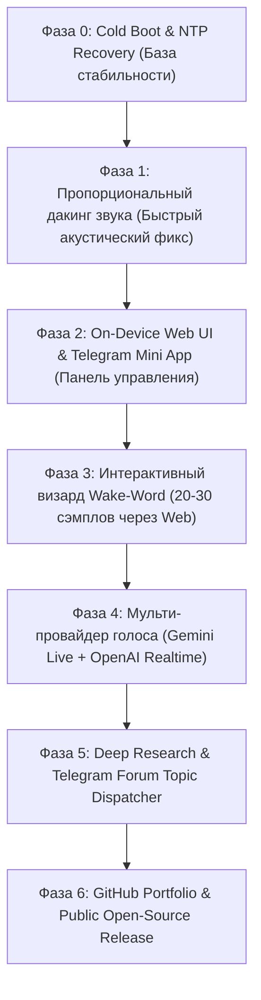

# Мастер-план эволюции GPT Mini: Автономия, Управление, Мульти-модели и Глубокий поиск

- Статус: planned (master-roadmap)
- Дата: 2026-11-10
- Владелец: gpt-mini team

## 1. Концепция и цель трансформации

Проект переходит от этапа базового реверс-инжиниринга и стабилизации железа к полноценному автономному продукту.
**Главная цель:** пользователь не должен быть «бытовым инвалидом», зависящим от агента и терминала для базовых действий (перезагрузка, смена голоса, цвета светодиода, переподключение к Wi-Fi или смена wake word).

Система должна предоставлять:
1. **Автономный Control Center (Web UI / Telegram Mini App)** прямо на колонке: управление всеми настройками без SSH и пересборки.
2. **Интерактивный визард обучения Wake Word:** запись 20–30 сэмплов с разного расстояния и интонаций прямо через браузер/телефон с авто-обрезкой и генерацией `.rpw`.
3. **Мульти-провайдерную голосовую платформу:** возможность переключения на лету между Gemini Live API и ChatGPT Voice (OpenAI Realtime API).
4. **Режим глубокого поиска (Deep Research):** детекция сложных запросов, голосовое удержание («Оставайся на связи, сейчас поищу...»), фоновый веб-скрейпинг, голосовое саммари и отправка подробного отчета в Telegram Forum Supergroup с отдельным топиком на каждый запрос.
5. **Идеальный акустический дакинг:** запоминание исходного уровня [1..10], пропорциональное приглушение при фразе и точный возврат в исходное значение.
6. **Отказоустойчивость питания (Cold Boot Recovery):** защита от сбоя NTP и рассинхронизации часов после отключения света.
7. **Готовность к публичному GitHub-релизу:** полная очистка секретов, исчерпывающая документация, схемы железа — презентабельный open-source проект уровня Senior Embedded/Systems Engineer.

---

## 2. Фазирование и строгий принцип последовательной разработки

В соответствии с обновлёнными правилами `AGENTS.md`:
> **Принцип одной задачи (Single-Task & Zero-Regression):** браться строго за одну изолированную задачу за раз. Никаких параллельных смешиваний. Сделано → протестировано → проверено на устройстве → закоммичено. Только затем переход к следующей.

---

## 3. Детализация фаз

| Фаза | Документ плана | Главный результат | Артефакт проверки |
|---|---|---|---|
| **0. Boot & NTP Watchdog** | `2026-11-10-power-recovery-and-ntp-watchdog.md` | Колонка поднимается после выключения света без зависаний TLS | Холодная перезагрузка питания восстанавливает диалог без SSH |
| **1. Proportional Ducking** | `2026-11-10-proportional-audio-ducking.md` | Точный возврат громкости: $V_{cur} \to \max(1, \lfloor V \times 0.3 \rfloor) \to V_{cur}$ | Тесты на уровнях 2, 5, 8, 10; отсутствие скачков громкости |
| **2. Web UI & Telegram App** | `2026-11-10-web-ui-and-control-center.md` | Панель управления на `http://gpt-mini.local:8080` и в Telegram | Смена голоса, цвета LED, ребут в один клик со смартфона |
| **3. Wake Word Enrollment UI** | `2026-11-10-wake-word-custom-enrollment-ui.md` | Обучение нового слова вызова через визард из 20–30 записей | Генерация `.rpw` в UI и мгновенная активация на колонке |
| **4. Multi-Provider Voice** | `2026-11-10-multi-provider-voice-architecture.md` | Абстракция VoiceProvider, поддержка ChatGPT Voice (OpenAI) | Переключение Gemini Live $\leftrightarrow$ OpenAI Realtime в UI |
| **5. Deep Research & Telegram** | `2026-11-10-deep-research-and-telegram-dispatcher.md` | Голосовой ресерч + создание топика в Telegram-форуме | Поиск цен dar.ge vs Edison с отчетом в топик Telegram |
| **6. GitHub Portfolio Release** | `2026-11-10-github-release-and-portfolio-readiness.md` | Чистый публичный репозиторий, документация, схемы | Публикация в аккаунт GitHub пользователя как портфолио |
