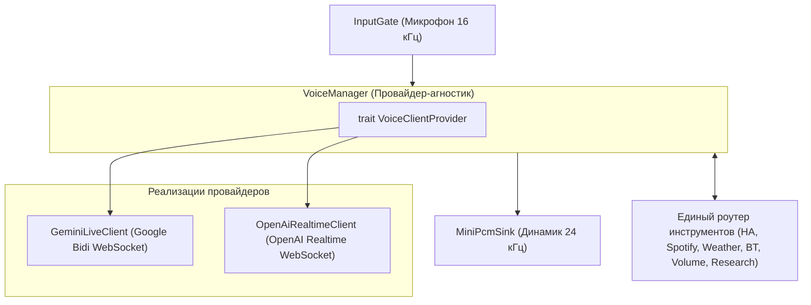

# План: Мульти-провайдерная голосовая архитектура (Gemini Live API + OpenAI ChatGPT Voice)

- Статус: planned
- Дата: 2026-11-10
- Владелец: gpt-mini, mini-assistant (`src/voice/`, `src/gemini/`, `src/openai/`)

## Проблема и цель

Сейчас колонка жестко привязана к одной облачной реализации — Google Gemini Live API (`src/gemini/live_client.rs`). Пользователь хочет иметь возможность свободно выбирать и переключать голосовую модель прямо из веб-интерфейса или Telegram:
- **Google Gemini Live API** (Gemini 2.0 Flash / Pro с голосами Callirrhoe, Puck, Autonoe, Aoede и др.);
- **OpenAI Realtime API / ChatGPT Voice** (GPT-4o Realtime с голосами Alloy, Echo, Shimmer, Ash, Ballad, Coral, Sage, Verse).

При этом все локальные инструменты (Home Assistant, Spotify, погода, Bluetooth, будильники, громкость, поиск) должны оставаться общими и работать одинаково надежно с любым выбранным провайдером.

---

## Архитектура голосовой абстракции



---

## Контракт VoiceClientProvider

В `src/voice/mod.rs` создаётся абстрактный трейт:

```rust
#[async_trait]
pub trait VoiceClientProvider: Send + Sync {
    /// Инициализация сессии и handshake с облаком
    async fn start(&mut self, config: &VoiceProviderConfig) -> Result<()>;

    /// Отправка аудиофрагмента пользователя (16 кГц PCM)
    async fn send_audio(&self, turn_id: u64, pcm_chunk: Vec<u8>) -> Result<()>;

    /// Окончание реплики пользователя
    async fn end_audio(&self, turn_id: u64) -> Result<()>;

    /// Акустический barge-in (прерывание ответа модели пользователем)
    async fn interrupt(&self) -> Result<()>;

    /// Мягкое закрытие сессии
    async fn shutdown(&mut self) -> Result<()>;

    /// Канал исходящего аудио модели (24 кГц PCM)
    fn subscribe_audio(&self) -> mpsc::Receiver<(u64, u64, Vec<u8>)>;

    /// Канал вызовов инструментов (Function Calling)
    fn subscribe_tool_calls(&self) -> mpsc::Receiver<ToolCall>;

    /// Отправка результата выполненного инструмента
    async fn send_tool_result(&self, call_id: String, result: serde_json::Value) -> Result<()>;
}
```

---

## Специфика OpenAI Realtime API (`src/openai/realtime_client.rs`)

1. **Транспорт:** WebSocket `wss://api.openai.com/v1/realtime?model=gpt-4o-realtime-preview`.
2. **Аутентификация:** `Authorization: Bearer <OPENAI_API_KEY>` либо OAuth Token пользователя.
3. **Формат аудио:**
   - Вход: `pcm16` 16000 Гц или 24000 Гц в base64 через событие `input_audio_buffer.append`.
   - Выход: `pcm16` 24000 Гц через событие `response.audio.delta` — **идеально совпадает с нашим `mini_pcm_sink`!**
4. **Событийная модель:**
   - `session.update`: настройка системного промпта, голоса (`alloy`, `echo`, `shimmer`, `ash`, `coral`, `sage`) и схемы деклараций инструментов (`tools`).
   - `response.function_call_arguments.done`: вызов тула с аргументами.
   - `conversation.item.create` + `response.create`: отправка результата тула обратно в контекст диалога.
5. **Прерывание (Barge-in):**
   - Отправка `response.cancel` при обнаружении wake word или VAD пользователя во время речи ассистента.

---

## Горячее переключение в Web UI

1. В `config.toml` задаётся секция:
   ```toml
   [voice]
   active_provider = "gemini" # или "openai"
   gemini_voice = "Callirrhoe"
   openai_voice = "alloy"
   ```
2. При смене провайдера в Web UI:
   - `VoiceManager` вызывает `active_client.shutdown()`.
   - Инициализирует новый инстанс (например, `OpenAiRealtimeClient`).
   - Переподключает каналы микрофона и динамика.
   - Динамик проигрывает звуковой сигнал переключения модели.
