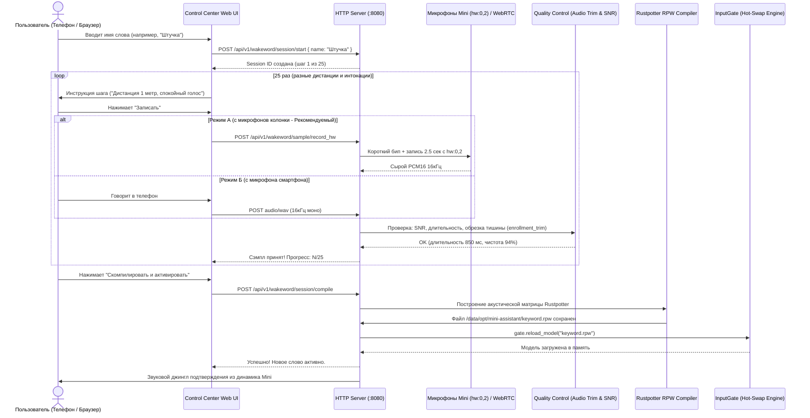

# План: Интерактивный визард обучения Wake-Word через Web UI и микрофоны GPT Mini

- Статус: planned
- Дата: 2026-11-10
- Владелец: gpt-mini, mini-assistant (`src/wakeword/`, `src/bin/keyword_enroll.rs`, `src/web/`)

## Проблема и цель

Сейчас обучение ключевого слова (wake word) требует ручной записи WAV-файлов через SSH, конвертации сэмплов, ручного запуска `keyword-enroll` и перезапуска службы. Пользователь не может самостоятельно обучить колонку новому слову вызова («Ассистент», «Джарвис», «Штучка» с персональным тембром).

**Цель:** создать интерактивный пошаговый визард в Control Center / Telegram Mini App, где пользователь за 3–5 минут записывает 20–30 сэмплов нового слова вызова с разной дистанции и интонации, а колонка на лету генерирует персонализированную модель `.rpw` и мгновенно активирует её без перезагрузки и без участия агента.

---

## Архитектура процесса обучения (Enrollment Pipeline)

---

## Методика сбора сэмплов (25 шагов для высокой надёжности)

Для исключения ложных срабатываний и устойчивости к шуму визард делит процесс на 4 фазы:

1. **Фаза 1: Ближняя зона (шаги 1–8):**
   - Расстояние: 0.5 – 1.0 метр.
   - Интонация: спокойная, нейтральная речь с обычной артикуляцией.
2. **Фаза 2: Средняя дистанция (шаги 9–16):**
   - Расстояние: 2.0 – 3.0 метра (из центра комнаты).
   - Интонация: естественный разговорный голос.
3. **Фаза 3: Повышенный тон и акценты (шаги 17–21):**
   - Расстояние: 3.0 – 4.0 метра.
   - Интонация: громкий зов, эмоциональный призыв, быстрый темп.
4. **Фаза 4: Сложные условия (шаги 22–25):**
   - Полушёпот, тихий вечерний голос, небольшое отклонение от фронтальной оси (сбоку от колонки).

---

## Автоматический контроль качества (Quality Control Engine)

Алгоритм, реализованный на базе `keyword_enroll.rs`:
1. **VAD Onset/Offset Detection:** автоматическое определение границ слова по динамическому порогу энергии.
2. **Очистка от фонового шума (`enrollment_trim`):** сохранение полезного сигнала с фиксированным запасом 100 мс тишины до и после слова.
3. **Проверка спектральной плотности:** отклонение сэмплов с клиппингом ($> -0.5\text{ dBFS}$) или слишком тихих ($< -35\text{ dBFS}$).
4. **Проверка длительности:** валидный диапазон $400\text{ мс} \le T \le 1800\text{ мс}$. Если пользователь кашлянул или замешкался, UI предлагает повторить шаг без поломки сессии.

---

## Горячая подмена модели (Hot Reload)

В `src/wakeword/mod.rs` и `src/wakeword/keyword.rs`:
- Добавляется метод `KeywordEngine::reload_from_file(&mut self, path: &Path) -> Result<()>`.
- `InputGate` оборачивает ключевой детектор в `Arc<RwLock<Box<dyn WakeWordEngine>>>`.
- В момент сохранения новой модели лок захватывается на ~2 миллисекунды, старая матрица вытесняется из памяти, новая компилируется и подхватывает аудиопоток.
- Перезапуск супервизора, SSH или потеря соединения не требуются.
