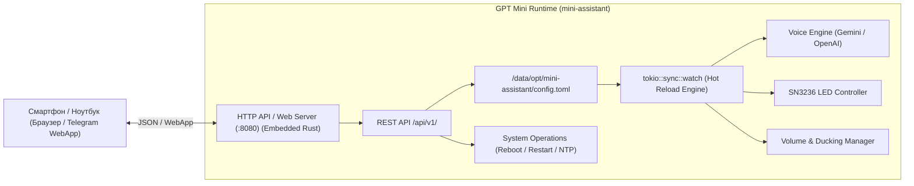

# План: Автономный Control Center (Web UI & Telegram Mini App) для GPT Mini

- Статус: planned
- Дата: 2026-11-10
- Владелец: gpt-mini, mini-assistant (`src/web/`, `src/config/`, `src/telegram/`)

## Проблема и цель

Пользователь вынужден обращаться к ИИ-агенту через терминал и промпты для выполнения рутинных бытовых задач:
- перезагрузить зависшую станцию;
- сменить голос модели (например, с Callirrhoe на Puck или Autonoe);
- изменить цвет или схему верхнего светодиода SN3236;
- перенастроить Wi-Fi или громкость.
Это создаёт зависимость («бытовой инвалид») и риск регрессий при перепрошивках.

**Цель:** создать автономный легковесный веб-интерфейс управления, размещённый прямо на GPT Mini, доступный:
1. В локальной сети по адресу `http://gpt-mini.local:8080` (или `http://10.77.0.111:8080`).
2. В Telegram через **Telegram Mini App (Web App)** по кнопке в боте колонки из любой точки мира.

---

## Архитектура Control Center

---

## Возможности интерфейса (UI Capabilities)

1. **Dashboard (Главный экран):**
   - Индикаторы состояния в реальном времени: статус подключения к облаку (Online / Reconnecting), текущий Wi-Fi SSID и уровень сигнала, аптайм, загрузка RAM (из 236 МБ) и CPU.
   - Текущий играющий трек Spotify, обложка, ползунок громкости 0–10.
   - Быстрые действия: «Мягкий перезапуск ассистента», «Перезагрузка колонки».
2. **Настройка Голоса и Модели:**
   - Выбор провайдера: **Google Gemini Live API** / **OpenAI Realtime (ChatGPT Voice)**.
   - Селектор голоса с превью:
     - Gemini: *Callirrhoe, Puck, Autonoe, Charon, Kore, Fenrir, Aoede*.
     - OpenAI: *Alloy, Echo, Shimmer, Ash, Ballad, Coral, Sage, Verse*.
   - Кнопка «Применить» мгновенно переинициализирует голосовую сессию без разрыва локального аудиопайплайна.
3. **Кастомизация верхнего светодиода (SN3236 RGB):**
   - Выбор базового цвета: лазурный (Classic GPT), фиолетовый, изумрудный, янтарный, белый, отключен.
   - Выбор паттерна: «Плавное дыхание», «Свечение только при ответе», «Реакция на громкость».
   - Мгновенное применение через I2C (`/dev/i2c-0`, адрес `0x3c`).
4. **Управление сетью и сервисами:**
   - Сканирование доступных Wi-Fi сетей и переподключение.
   - Статус Bluetooth-видимости (переключатель Discoverable Mode).
   - Проверка синхронизации часов (NTP status).

---

## Технический стек и реализация

- **Zero-Dependency Single-Binary UI:** интерфейс пишется на чистом современном HTML5/CSS3 (vanilla, без тяжелых фреймворков node_modules), пакуется с помощью `include_str!` или `flate2` прямо в бинарник `mini-assistant`. Потребление памяти < 1 МБ RAM.
- **REST API (`/api/v1/...`):**
  - `GET /api/v1/status` — полный снапшот состояния.
  - `POST /api/v1/voice` — сменяет голос/провайдер в `config.toml` и вызывает `voice_client.reconnect_with_voice(voice)`.
  - `POST /api/v1/led` — передаёт RGB-значения в контроллер `sn3236`.
  - `POST /api/v1/volume` — установка громкости 0..10.
  - `POST /api/v1/system/restart` — мягкий перезапуск `mini-assistant` через супервизор.
  - `POST /api/v1/system/reboot` — системный reboot Linux.
- **Telegram WebApp:**
  - Телеграм-бот отправляет `InlineKeyboardButton` с полем `web_app: { url: "https://<mini-tunnel-or-local>/" }`.
  - Валидация `initData` через HMAC-SHA256 для защиты API от неавторизованного доступа.
