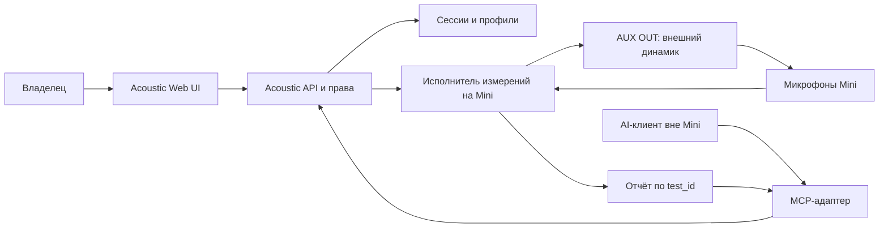

# План реализации: автономная акустическая калибровка GPT Mini через API

- Статус: draft — план подготовлен; реализация этапов не выполнена.
- Дата: 22.11.2026.
- Владелец: координатор `gpt-mini`; код устройства — `mini-assistant`.
- Основание: [аудит продукта](../ACOUSTIC_AGENT_REVIEW_2026-11-22_RU.md),
  [план надёжности KWS](2026-11-22-wakeword-reliability.md).
- Проверенный HEAD приложения: `241920979bf35a092dd9754da58df496d07e5c9b`.
- Исходные Git-деревья чистые. Эта задача меняет документацию, не устройство.

## 1. Результат для пользователя

Пользователь открывает Acoustic, подключает внешний активный динамик к AUX OUT,
указывает его положение, предоставляет записи и запускает разрешённую сессию.
Подключённый AI-агент работает исключительно через Acoustic API/MCP:
читает схему, меняет все доступные параметры, проводит ограниченные испытания,
сравнивает кандидатов, создаёт/редактирует/именует профили помещений,
сохраняет результат и приглашает владельца на заключительную проверку.

Ручная страница и агент используют одинаковые операции. Агенту не нужны
браузерные клики, SSH, shell, пути файлов или редактирование исходников.
Готовность инструментария не означает гарантированное существование идеального
профиля: допустимый исход — «кандидат не найден», отчёт и восстановленный baseline.

## 2. Архитектурное решение и границы

Рассмотрены два варианта:

1. LLM по одному двигает параметры и читает накопительные счётчики. Этот вариант
   не обеспечивает привязку результатов к опыту, дорог по вызовам и плохо повторяется.
2. Детерминированный исполнитель выполняет ограниченные измерительные задания,
   а агент управляет планом экспериментов через структурированные операции.
   **Выбран вариант 2.** MCP — адаптер уже проверенного API.



Прикладной executor/API/аудио остаются на Mini, на Rust, с учётом ARM32/armhf,
236 MiB RAM и существующего renderer. AI-клиент и тяжёлое сравнение записей —
на Mac или отдельном хосте. Pi по-прежнему обслуживает только Home Assistant.
Работающие Wi-Fi, музыка, голоса, будильники и доступ не заменяются побочно.

### Владельцы состояния

| Компонент | Единственная ответственность |
|---|---|
| Acoustic settings | Типы, диапазоны, канонические значения, runtime ACK, saved/applied |
| ProfileStore | Версии именованных профилей и их атомарное хранение |
| SampleStore | Разрешённые аудиообъекты и разметка, квоты и сроки хранения |
| CalibrationSession | Права, baseline, lease, бюджет, блокировка cloud/tools и восстановление |
| AudioTestRunner | Один измерительный job, владение аудио, capture/playback/cancel |
| Evaluator | События, разметка, ошибки, задержки и сравнение кандидатов |
| Web/MCP | Проверка запросов и отображение; не второй владелец состояния |

## 3. Обязательные инварианты

- Пока активна измерительная сессия, cloud PCM и HA/Spotify/другие voice tools
  запрещены отдельным локальным разрешением. `shadow_mode=false`, импорт
  профиля или восстановление defaults не снимают эту блокировку.
- Shadow сохраняет непрерывную историю KWS, но не запускает обычный диалог,
  chime или ducking. Наблюдение детектора и разрешение действия разделены.
- Локальные испытания работают без Gemini/OpenAI, ключа провайдера и интернета.
- Аппаратный mute не обходится. Будильник и явное действие владельца имеют
  приоритет; конфликтующий опыт останавливается, а не глушит будильник.
- Параметры применяются пакетом с matching ACK. Поля запроса не получают
  молчаливые defaults; сохранение и применение показываются отдельно.
- Пробный кандидат живёт в RAM в пределах сессии. Не переписывать flash при
  каждом шаге оптимизатора; постоянное сохранение выполняется явно.
- Каждый опыт имеет ID, объявленную разметку, профиль/модель/версию тракта,
  источник, маршрут, временную привязку и конечный результат.
- Повтор сетевого запроса не создаёт второе воспроизведение или вторую запись.
- AUX недоступен — `unsupported`, без скрытого включения встроенного динамика.
- Отмена/тайм-аут/отзыв доступа прекращают звук и запись независимо от связи с агентом.
- После рестарта старый клиент не может перезаписать новое состояние старой версией.
- Агенту не выдаются сторонние credentials. Аудио не отправляется в LLM автоматически;
  прослушивание/выдача разрешённых записей — отдельная операция и право.

## 4. Последовательные этапы реализации

Каждый подпункт — отдельное связное изменение с regression test. Следующий этап
начинается после его ворот: тесты, review, focused commit, необходимая проверка
на устройстве по регламенту. Форматирование не смешивается с изменением поведения.

### Этап 0 · Восстановить честный зелёный baseline (ВЫПОЛНЕНО)

- [x] Зафиксировать версии Rust/Clippy/Node и cross image; одинаковая версия
  toolchain используется локально и в CI. Cargo.lock сохраняется.
- [x] Исправить форматирование отдельным коммитом по фактическому списку файлов (`ea4560e`).
- [x] Исправить Clippy без отключения `-D warnings`: constant chunks в acoustics
  и alarm sound (`as_chunks`), индексный цикл enrollment; проверить прежние границы буферов (`2419209`).
- [x] Разобрать воспроизводимый отказ keyword-enroll на строке 672. Сопоставить
  момент детекции, eager/countdown и ожидаемое окно синтетической разметки.
  Разделены eager и delayed конфигурации в тестах (`2419209`).
- [x] Сделать quality job, который запускает все обязательные проверки и
  сохраняет результаты каждой, даже если предыдущая завершилась ошибкой (`scripts/check.sh`, `tests/test_check_runner.py`).

**Ворота:** fmt, Clippy, все Rust targets, Python/UI tests и vendor tests PASS (5/5 stages pass).

### Этап 1 · Исправить контракт настроек и интерфейс (F2, F3, F5–F9)

- [x] Разделить совместимую TOML-конфигурацию и строгий сетевой DTO полного
  профиля. Отсутствующее/неизвестное поле, NaN, неверный тип или диапазон → ошибка
  до изменения RAM/диска. В первой версии не вводить неявный PATCH.
- [x] Определить канонические score modes и числовые единицы. Одна schema
  управляет backend-валидацией и UI; совместимые aliases нормализуются на границе.
- [x] У каждого параметра schema указывает момент применения: live, следующий
  capture или несовместимое изменение. Startup suppression проверяется заданием
  с новым capture в пределах audio lease, без выдачи агенту system/restart.
- [x] Устранить f32/stepMismatch, ошибки границ и blanket epsilon. Точность
  отображения/сравнения согласована с полем; допустимый шаг gain_ref не исчезает.
- [x] Состояние содержит `runtime_instance_id`, saved/applied revisions и
  подтверждение аудиоцикла. Мутации имеют If-Match; после restart instance
  меняется и старый запрос получает 409/412. Версии сохранённых объектов устойчивы.
- [x] Различать pending, rejected, ACK channel closed и timeout. Для каждого
  состояния доступны восстановление и наблюдаемый результат; вечного pending нет.
- [x] В UI показывать applied_revision отдельно от saved_revision и дать
  реальное «Восстановить рабочий профиль», даже если форма уже совпадает с applied.
- [x] Проверить сохранение остальных TOML-секций и одновременные операции других
  карточек: общий сериализованный владелец записи/версия файла, без lost update.

**Ворота:** все 33 поля проходят roundtrip и реальные browser constraints;
частичный профиль отклоняется; errors/closed ACK/restart/conflict/restore
воспроизводятся mock-тестами. Импорт/экспорт работают на min/max и alias-входах.

### Этап 2 · Исправить shadow и выделить независимое наблюдение (F1)

- [x] Убрать reset на каждом чанке, сохранить MFCC/DTW-историю до события.
- [x] Вынести PCM observation/test dispatch из жизненного цикла облачного
  клиента. `Stopped`, reconnect и недоступный провайдер не блокируют лабораторию.
- [x] Подключить режим наблюдения к production matcher/preprocessing. Отдельно
  учитывать raw detection и итоговое решение gate с причиной подавления.
- [x] Включение тестовой сессии отзывает старый turn, блокирует stale queued
  PCM/tool calls, исключает chime/ducking от контрольных обращений.
- [x] Выдать события с sample offsets/sequence и snapshot конфигурации;
  cumulative counters остаются обзором, а не метрикой качества испытания.

**Ворота:** один непрерывный PCM даёт сопоставимые raw detections в shadow и
normal; shadow не даёт cloud/tools/озвучивания. Это проверяется с настоящим
matcher на synthetic positive/negative и с fake transport, а не только mock boolean.

### Этап 3 · Ввести ограниченный доступ и управление сессией

- [x] Владелец через UI выдаёт отдельную calibration identity со сроком и
  scopes: settings/profiles, разрешённые samples, capture/playback/jobs/reports.
- [x] Проверять identity до route dispatch. Пустой, отсутствующий, неверный,
  истёкший и отозванный token не включают анонимный режим.
- [x] Calibration identity не может вызвать system/reboot/restart, voice,
  Spotify, Wi-Fi или старые enrollment/admin aliases. Защитить административные
  мутации owner identity, чтобы сброс заголовка авторизации не обходил ограничения.
- [x] UI сессия и machine-client доступ имеют общую серверную политику;
  Origin/CSRF дополняют её, но не считаются авторизацией.
- [x] Локальный MCP сначала stdio на Mac; доступ к Mini по защищённому каналу,
  без публикации LAN HTTP с bearer в интернет. Секреты не в URL/логах/профилях.
- [x] Сессия содержит lease, baseline, режим источника, пределы длительности,
  громкости, числа опытов и хранения. Нет бесконечных полномочий из одного job ID.

**Ворота:** проверка разрешённых/запрещённых маршрутов реальными HTTP fixtures;
подмена actor/ID, повтор, отсутствие Origin/token и обход через alias не расширяют
права. Отзыв lease останавливает тест локально. (Выполнено: `test_http_auth_and_calibration_lifecycle`, unit-тесты `AuthManager`, MCP adapter `scripts/mcp_acoustic_agent.py`, `test_mcp_acoustic_agent.py`).

### Этап 4 · Профили помещений и временные кандидаты

- [x] Реализовать list/create/read/update/rename/archive/delete/activate по
  стабильному ID; отображаемое имя комнаты не является путём файла.
- [x] Profile хранит schema_version, revision, name/notes, все настройки,
  model ID/hash, версию аудиотракта, условия и ссылки на отчёты.
- [x] Статусы `draft`, `automated_tested`, `owner_confirmed` различаются.
  Агент не может присвоить отметку человеческой проверки.
- [x] Preview кандидата применяется в RAM с ACK и TTL. Save/activate/restore
  — явные атомарные операции с версией. Повтор с тем же Idempotency-Key не дублирует запись.
- [x] Предусмотреть backup/export/import с валидацией совместимости; смена
  модели/канала/тракта помечает старый результат как требующий повторной проверки.

**Ворота:** UI и API выполняют один lifecycle профиля; конкуренция, неверный
ID, schema migration, power loss при записи и восстановление проверены без Mini. (Выполнено: `test_http_profiles_lifecycle_and_candidate_preview`, unit-тесты `ProfilesStore`, UI в `acoustic_lab.html`, MCP tools в `mcp_acoustic_agent.py`).

### Этап 5 · Библиотека записей и качество данных

- [x] Отделить контрольные samples от временного enrollment. Операции:
  upload, metadata/list, ограниченная capture, download/listen, label, archive/delete.
  Доступ только по object ID, без произвольных URL/путей и shell-конвертации.
- [x] Первая версия принимает валидированный mono PCM16 WAV 16 кГц; максимальная
  длительность одного сохранённого клипа — 60 с (около 1,92 MB PCM). Остальные
  форматы конвертируются разрешённым клиентом перед загрузкой.
- [x] Capture имеет отдельный измерительный путь: запись не выключает KWS.
  Указать, какие PCM/preprocessing сохранены; не считать record_hw готовым test recorder.
- [x] Разметить positive/negative/own-output, точные интервалы wake-word,
  условия и train/calibration/held-out split по отдельным сеансам.
- [x] Исправить завышенный SNR и отбор min(min similarity), не возвращать
  отброшенные образцы ради количества. Проверять целое слово и фон до/после.
  В нынешнем baseline эти дефекты всё ещё присутствуют в enrollment.
- [x] Граничные PCM, включая i16::MIN, не вызывают panic/переполнение при
  подсчёте амплитуды и корректно распознаются как clipping.
- [x] Разнообразие не заменяет качество: сохранять разные полные произнесения
  одного обращения. Лимит 3–8 шаблонов остаётся до отдельного измерения CPU.
- [x] Profile ссылается на неизменяемую модель. Если нужен новый набор эталонов,
  выделить ограниченную операцию build/validate по разрешённым sample IDs;
  контрольные held-out данные не включаются в обучение автоматически.

**Ворота:** неверный WAV/размер/rate/truncation/label отклоняется; upload→capture
metadata→download roundtrip доказан; обучение и контроль не смешиваются. (Выполнено: `test_http_samples_lifecycle_and_validation`, unit-тесты `acoustics::samples`, `SamplesStore`, WAV PCM16 validator, MCP tools в `mcp_acoustic_agent.py`, fix `i16::MIN` clipping detection).

### Этап 6 · Исполнитель звуковых опытов, включая внешний динамик на 2 м

- [ ] Реализовать конечное задание с test_id и явным stimulus origin
  (`external_user_position`, `own_output`, `ambient`) отдельно от output route
  (`built_in`, `aux_out`). Capture input — микрофоны Mini, jack — выход.
- [ ] До первого AUX-опыта подтвердить реальный ALSA/native маршрут и работу
  внешнего активного динамика. Не угадывать control и не менять firmware/boot.
- [ ] Capture начинается до playback, сохраняет фон и хвост. Использовать
  sample timestamps, playback ACK/END/drain, известный marker/correlation;
  ожидание фиксированных 500 мс не заменяет синхронизацию.
  Capture-ready означает стабильный PCM после прогрева, а не только созданный процесс.
- [ ] Контрольная запись wake-word с внешней колонки — positive. Собственное
  воспроизведение — проверка подавления открытия turn. Во время теста raw KWS
  измеряется даже если обычный gate подавил бы own-output; облако остаётся закрыто.
- [ ] Сначала небольшая библиотека заданных сигналов/записей с ограниченными
  уровнем и длительностью; не давать агенту бесконтрольный генератор или автогромкость.
  Перед опытом владелец задаёт комфортный уровень внешнего усилителя: dBFS не равен SPL.
- [ ] Один foreground job владеет capture/playback lease. Cancel/timeout/mute,
  будильник или действие владельца прерывают job с очисткой renderer/дочерних процессов.
  После вмешательства владельца агент не возобновляет опыт автоматически.
- [ ] Длинный фон анализируется потоково, без хранения часов PCM в RAM/flash.
  После baseline свободной памяти/flash назначить явные квоты clips/reports/logs;
  входы ограничиваются до выделения памяти, upload не заполняет раздел.

**Ворота:** fake clock/renderer доказывает порядок capture/play/drain/tail;
на Mini отдельный ограниченный опыт подтверждает AUX, временную привязку,
остановку и отсутствие cloud/tool side effects. Сборка не заменяет услышанный звук.

### Этап 7 · Отчёт измерения и автоматический подбор

- [ ] Отчёт job связывает profile/model/sample hashes, разметку, источник,
  фактические параметры, capture/drop/clipping stats и события по времени.
- [ ] Считать recall/пропуски, ложные события на час по категориям, дополнительные
  detections внутри positive и задержку. Дедупликация не скрывает серийные срабатывания.
- [ ] Короткий широкополосный sweep с захваченным откликом может оценивать
  относительное затухание тракта. Один 440 Гц/RMS не выдаётся за RT60/АЧХ;
  внешняя колонка добавляет собственную характеристику. Для основной KWS-приёмки
  важнее positive/negative ошибки, чем автоматический «балл комнаты».
  Анализ фиксированного 16 кГц потока ограничен частотами ниже 8 кГц;
  некорректно захваченный стимул даёт статус invalid, а не ноль ошибок.
- [ ] На Mac/внешнем хосте выполнить ограниченный программный поиск по одному
  фиксированному calibration corpus. LLM получает компактные таблицы/выборки,
  а не каждый PCM-кадр и не раз в секунду скриншот.
- [ ] Отобрать кандидата по обеим ошибкам и ресурсам, заморозить до held-out.
  Число попыток/время/громкость ограничены; агент завершает задачу при отсутствии
  подходящего кандидата, не переобучает владельца бесконечно.

**Ворота:** evaluator проверяется на синтетическом ground truth, событиях на
границах окон, пропусках, дублях и сбоях. Повтор корпуса даёт воспроизводимый
результат; технически испорченная запись не становится «плохой акустикой».

### Этап 8 · Достроить Acoustic и подключить API/MCP-клиента

- [ ] В том же разделе добавить именованные профили, samples с прослушиванием,
  настройку источника/условий, сессию, запуск/остановку и сравнение отчётов.
- [ ] Экран показывает только действительные capabilities; отсутствующий AUX,
  несовместимая модель или недоступная функция не маскируются успешной кнопкой.
- [ ] Опубликовать versioned OpenAPI/JSON Schema и примеры; генерировать
  MCP input/output schemas из общего контракта. Проверить дрейф схем в CI.
- [ ] MCP имеет только именованные операции Acoustic, без generic HTTP/shell/SSH.
  Совместимый агент использует предоставленные credentials и задаёт критерии,
  а алгоритм перебора/измерения остаётся тестируемой программой.
- [ ] Уведомление «нужен живой контроль» отображается в UI/агентском клиенте.
  Telegram — необязательный адаптер позднее; не добавлять бота как зависимость MVP.

**Ворота:** один scripted API-клиент выполняет весь сценарий без браузера,
затем тот же сценарий выполняется MCP-клиентом. Реальный LLM smoke отдельный;
наличие MCP не является доказательством работы измерений.

### Этап 9 · Общая приёмка и релиз

- [ ] Все regression/host/API/browser tests PASS. Отдельный browser-тест
  использует настоящие number.validity/reportValidity и все 33 поля.
- [ ] ARM32 build из committed HEAD, ELF/NEEDED, полный SHA256; deploy/BUILD_INFO
  и verify_deploy PASS по регламенту. Один supervisor/audio owner, без сирот.
- [ ] Ограниченный опыт: внешняя колонка на 2 м, known positive/negative,
  два именованных профиля, cancel и восстановление, затем новые обращения владельца.
- [ ] Длительная отрицательная проверка с разбивкой речь/ТВ/музыка/тишина.
  Критерии KWS и границы интерпретации — по плану надёжности; 0 за 8 ч не «навсегда».
- [ ] Проверить сохранение и активацию после cold boot. После сессии обычные
  Gemini/Spotify/громкость/будильники и Home Assistant не потеряны; реальные действия
  выполняются только в отдельно согласованных сценариях.
- [ ] Русская и английская документация API, подключения агента, прав,
  профилей, восстановления и условий измерений; итоговый реестр capabilities.

**Ворота:** агент без доступа к коду/SSH провёл ограниченную серию, получил
достоверный отчёт, сохранил именованный профиль, восстановил/активировал его;
плохие запросы, повторы и отказы не исполнили ничего вне Acoustic.

## 5. Минимальный API-контракт для клиента

Все ресурсы находятся под `/api/v1/acoustics`. UI и MCP не вводят второй API.
Существующий GET можно сохранить как агрегированный snapshot; legacy POST
после миграции UI не должен обходить строгую валидацию/права.

| Ресурс | Операции и условия |
|---|---|
| `/schema`, `/state` | Типы, диапазоны, capabilities, instance, saved/applied revisions, model hash |
| `/settings` | Полный профиль + If-Match; ACK или явная ошибка |
| `/profiles`, `/profiles/{id}` | CRUD/rename, версия и schema; имена не пути |
| `/profiles/{id}/activate` | Конкретная версия, matching ACK, Idempotency-Key |
| `/samples`, `/samples/{id}` | Upload/list/metadata/labels/archive |
| `/samples/{id}/audio` | Ограниченный download/listen разрешённой записи |
| `/models`, `/models/{id}` | Валидировать/собрать из разрешённых train samples при наличии этой capability |
| `/sessions`, `/sessions/{id}` | Создать/прочитать ограниченную сессию, baseline и состояние |
| `/sessions/{id}/candidate` | Применить полный временный профиль в RAM с ACK/версией |
| `/sessions/{id}/jobs`, `/jobs/{id}` | Capture/playback/measure/replay suite; получить состояние и report |
| `/jobs/{id}/events` | Ограниченный cursor-based журнал с sample offsets и причинами решений |
| `/jobs/{id}/cancel` | Идемпотентная отмена, cleanup подтверждён отдельно |
| `/sessions/{id}/restore`, `/finish` | Восстановить baseline или сохранить профиль/отчёт и завершить |

Мутации проверяют ownership/scopes, If-Match и Idempotency-Key, связанный с
actor + hash запроса. Повтор ключа с другим payload → конфликт. IDs сами по
себе не являются авторизацией. Схема ошибок: invalid/unauthorized/forbidden,
conflict/busy/unsupported/timeout/storage/audio_failure; ошибка не выглядит как success.

## 6. Жизненный цикл и восстановление

```text
created → preparing → running → evaluating → awaiting_owner → completed
                   ↘ cancelling → restoring → cancelled
                   ↘ failed → restoring → failed_restored
```

Job имеет собственные queued/capturing/playing/draining/analyzing/finished,
failed/cancelled. Все конечные состояния освобождают ресурсы. Блокировка
автоматизации облака снимается только после подтверждённого завершения/восстановления.

До первого изменения сессия пишет небольшой durable recovery record baseline.
Кандидаты не становятся новым startup config автоматически. При power loss
незавершённая сессия восстанавливается до включения обычной голосовой работы.
Если baseline повреждён, сохраняется запрет автоматизации и явная ошибка.
Отмена не перезаписывает более новое ручное изменение владельца старой копией:
проверяются версия и владение, конфликт виден в UI.

## 7. Приёмочный сценарий одного агента

1. Авторизоваться calibration identity; прочитать schema/state и capabilities.
2. Создать сессию с пределами, baseline и условием AUX/2 м.
3. Загрузить/выбрать recordings, получить их metadata и разрешённое аудио.
4. Применить кандидат с matching ACK; запустить capture+playback job.
5. Повторить запрос с тем же ключом: получить тот же ID, без второго звука.
6. Получить отчёт; сравнить несколько кандидатов в заданном бюджете.
7. Проверить cancel/timeout и восстановление; административные вызовы запрещены.
8. Проверить замороженный кандидат на отдельном наборе; сохранить/переименовать
   профиль комнаты, активировать его конкретную версию и вызвать обратное переключение.
9. Позвать владельца на новые живые обращения; отметку owner_confirmed ставит владелец.
10. Завершить с сохранённым отчётом или честным «кандидат не найден» и baseline.

Сначала сценарий проходит программный mock-клиент. Только затем его выполняет AI,
чтобы ошибки оркестрации не маскировали отсутствующие механизмы продукта.

## 8. Связь с ревью и ведение работ

| Замечания/пробел | Закрывающий этап |
|---|---|
| fmt, Clippy, keyword-enroll regression | 0 |
| F2/F3/F5/F6/F7/F8/F9: DTO/числа/версии/ACK/UI restore | 1 |
| F1: shadow и накопление истории | 2 |
| F4: изоляция calibration identity | 3 |
| Комнатные профили и временные кандидаты | 4 |
| Записи, качество, прослушивание и независимая разметка | 5 |
| AUX/capture/playback/cancel/ограничения | 6 |
| Отчёты, метрики и ограниченный поиск | 7 |
| UI workflow, API schema и MCP | 8 |
| Доказательство полного сценария и регрессий на Mini | 9 |

Каждая следующая рабочая сессия отмечает только фактически завершённые пункты,
их commit/hash, команды и результат. Не ставить done по числу файлов, HTTP 200
или наличию endpoint. Диагностические snapshots имеют отдельный CARGO_TARGET_DIR.
Приватные samples, модели, токены и сырые журналы вне Git.

## 9. Проверки и ограничения текущей задачи

В этой задаче подготовлен и отревьюен только план. Исходные результаты проверок
остаются в аудите; они не превратились в PASS из-за появления документа.
Новых акустических тестов, deployment или изменений приложения не выполнялось.

Первая реализационная задача — **этап 0: зелёный baseline с разбором реальной
регрессии keyword-enroll**. Затем этапы 1 и 2 закрывают уже воспроизведённые
дефекты лаборатории до добавления автономного агента.

Позднее принятый профиль можно зафиксировать как версионированный эталон/default
в коде отдельным developer-коммитом. Сам агент не меняет код; ручное управление
и профили помещений сохраняются. Профили «Эхо» и «Ковры» не обязаны иметь одинаковые
числа, а более длинный echo tail не считается устранением реверберации комнаты.
